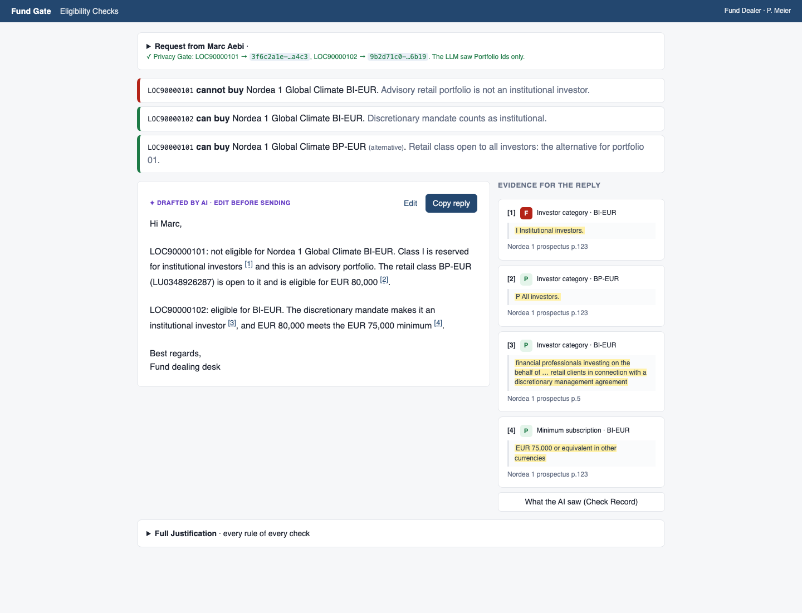
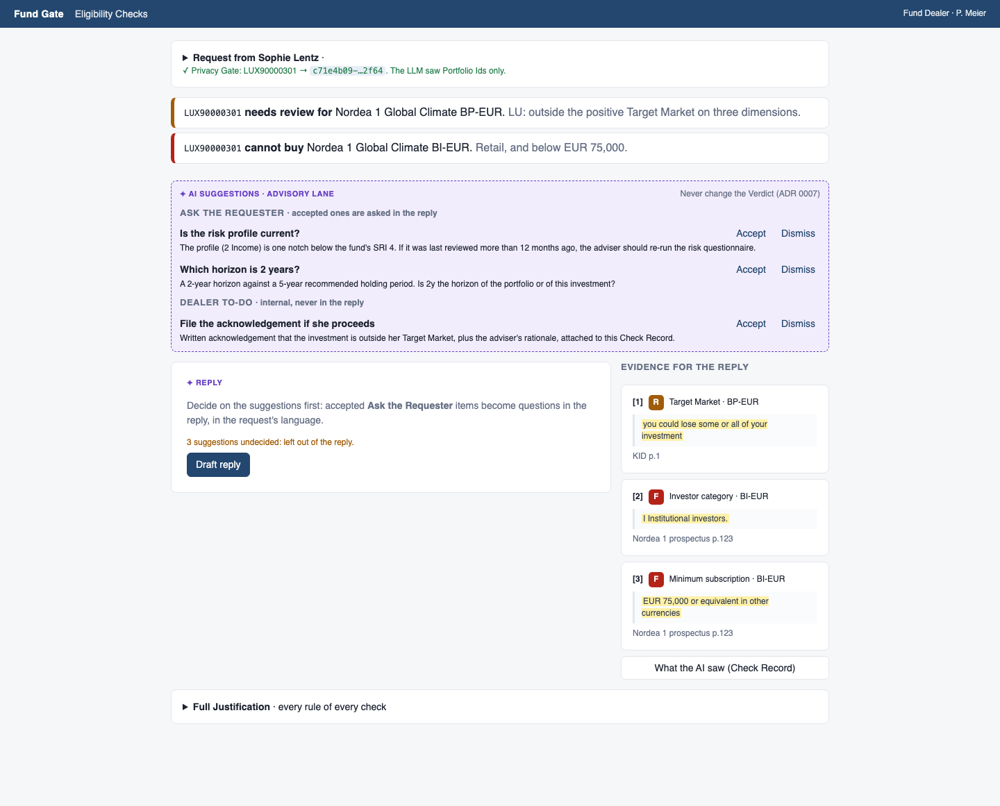
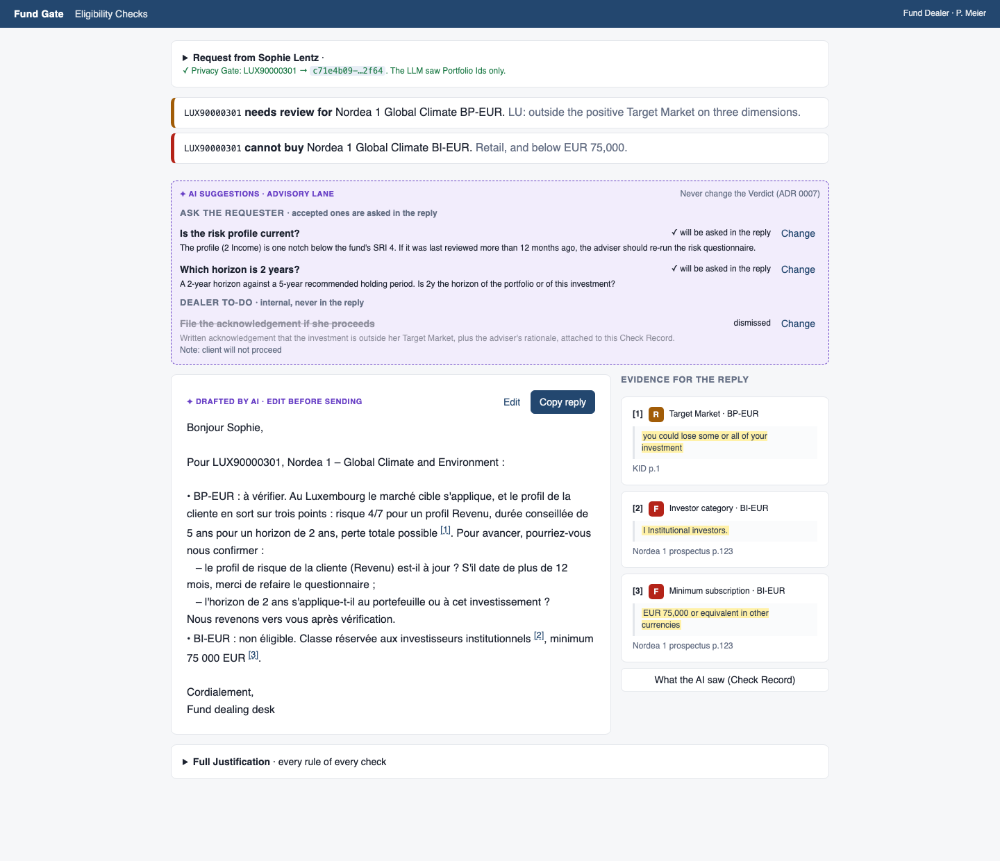
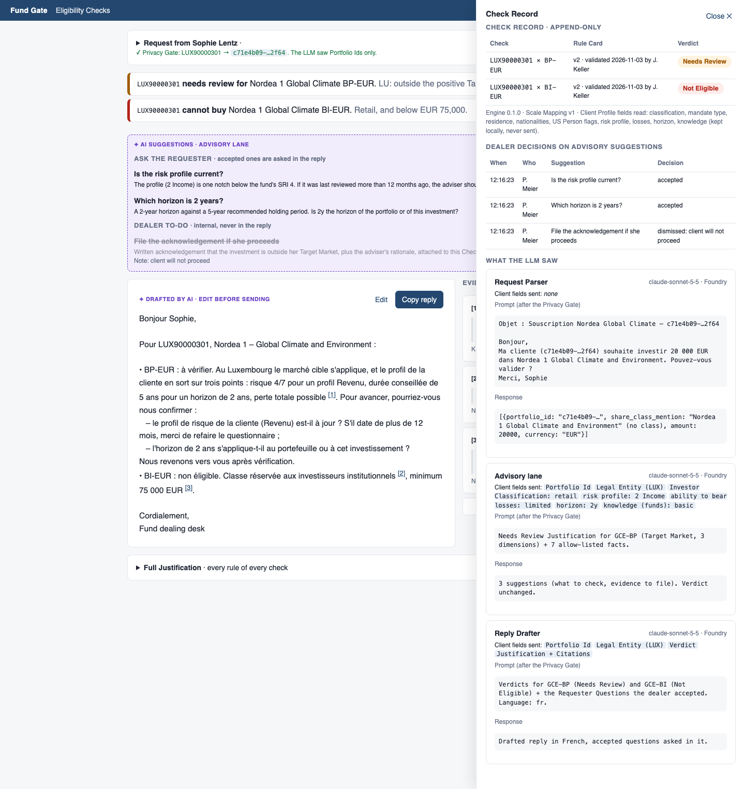
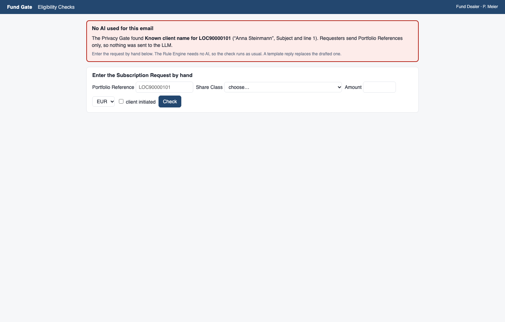
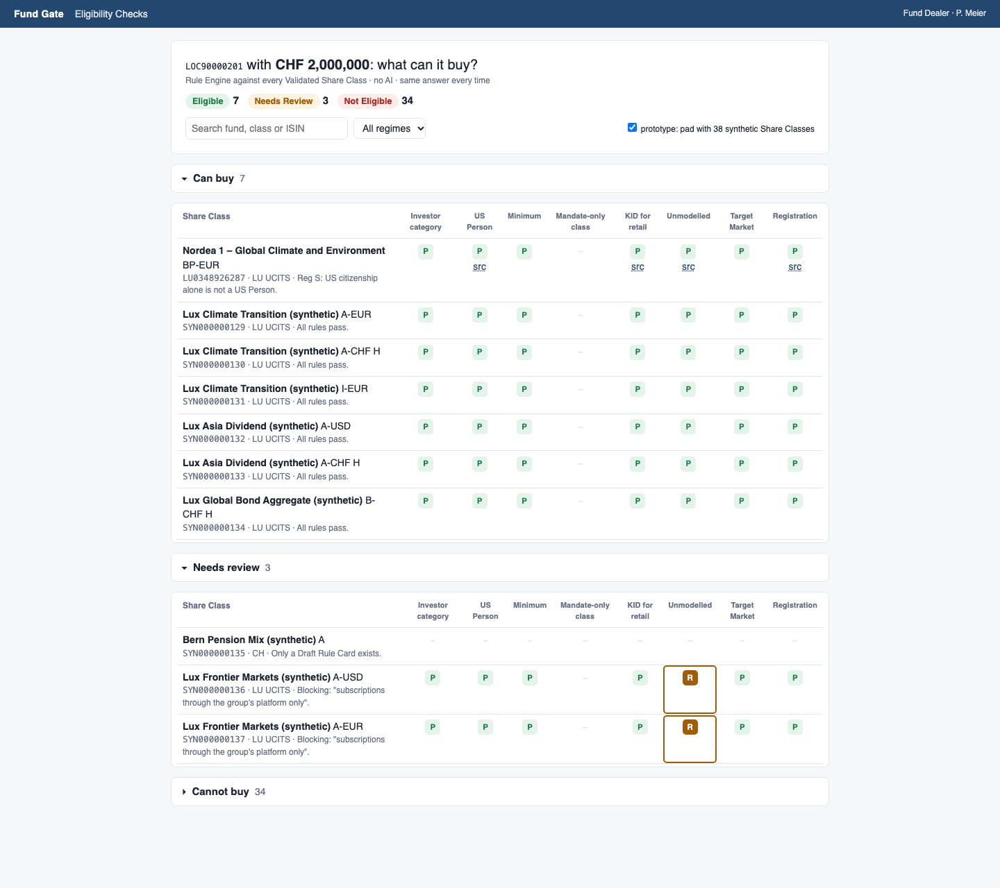
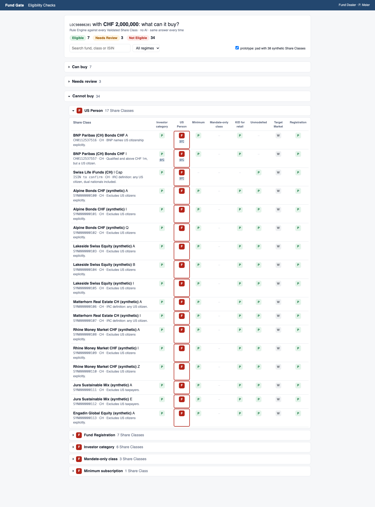
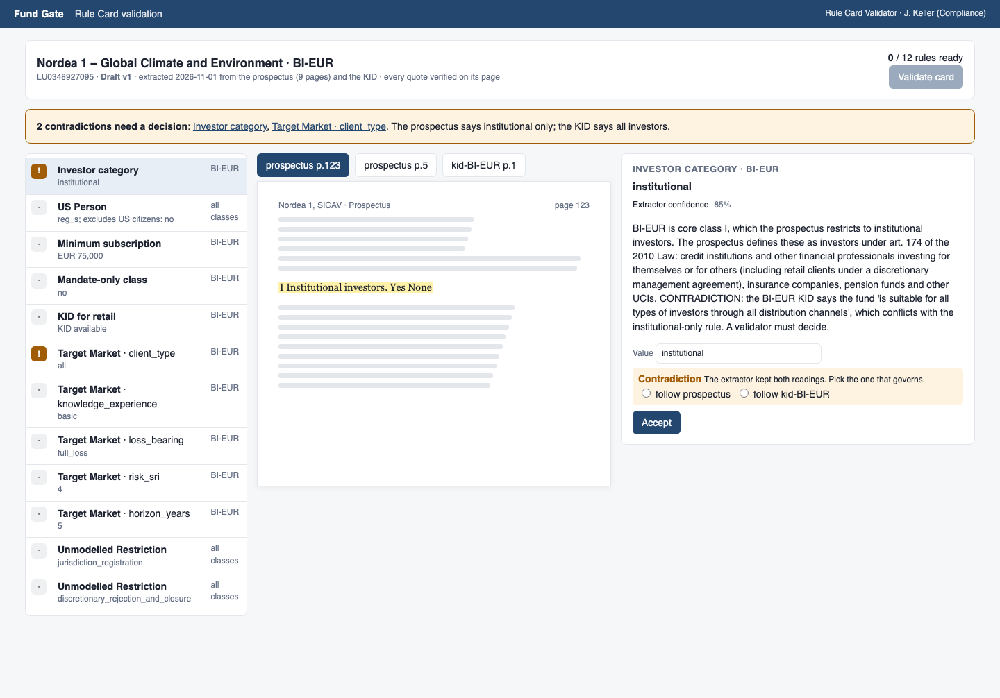
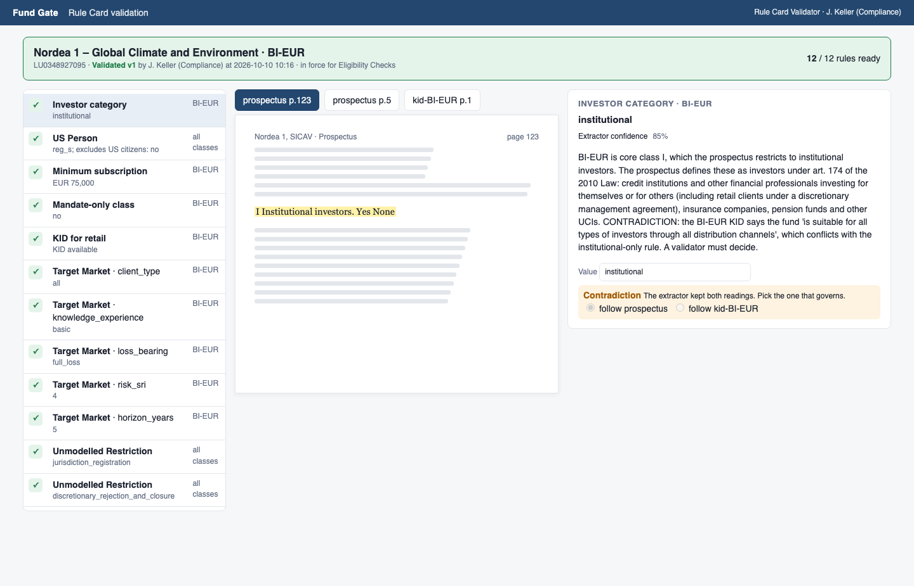

# Screens prototype (throwaway)

Answers [#17](https://github.com/smnajid/fund-gate/issues/17): what should the dealer screen and the Rule Card validation screen look like? Not product code: plain HTML and JS so it runs with no build. The real screens are Angular ([ADR 0006](../../docs/adr/0006-spring-boot-and-angular-python-only-for-real-added-value.md)).

**Run:** `open spikes/screens/index.html` (double-click works too).

Use the floating bar or `←` `→` to switch variants, the dropdown for the dealer scenario, **reset** to start over and **state** to see the in-memory state. Every view has a shareable URL, e.g. `index.html?screen=dealer&variant=B&scenario=claire&stage=checked`.

| Screen | A | B | C |
|---|---|---|---|
| Dealer | Single column, top to bottom: request → parsed requests → Verdicts → reply | Three-pane workbench: inbox, request + checks, detail with Justification / Reply / Check Record tabs | Reply-first answer sheet: one sentence per Verdict, the drafted reply with an evidence rail |
| Validation | Document beside the rules: rule list, page with the quote highlighted, editor | One rule at a time with a progress bar | Dense table, contradictions pinned on top |

Scenarios come from the coverage set in [demo-dataset.md](../../docs/playbook/demo-dataset.md): **Anna** (rows 1–3), **Claire** (rows 10–11 + advisory lane), **Tom** (reverse lookup, rows 4–9), **Guard** (Privacy Gate refusal). The validation screen loads the real Draft card for Nordea 1 GCE BI-EUR from the extraction spike run (`rule-card.js`), including its two KID-vs-prospectus contradictions.

Variant C's reverse lookup is the long-list shape: Share Classes as rows, the rule kinds as columns, grouped by Verdict, with Cannot buy sub-grouped by the deciding rule. A checkbox pads Tom's 6 real rows with 38 synthetic Share Classes ("(synthetic)", ISINs starting SYN) so you can see it long.

Nothing is computed: Verdicts, replies and LLM traffic are hand-written.

## Screenshots of the chosen design

Decision: [`docs/playbook/screens.md`](../../docs/playbook/screens.md). Dealer screen = variant C, validation screen = variant A with the contradiction banner.

| | |
|---|---|
| **Anna**: one sentence per Verdict, reply with evidence rail  | **Claire**: Advisory Suggestions before the reply is drafted  |
| **Claire**: two Requester Questions accepted, asked in the French reply  | **Check Record**: what the AI saw, and the dealer's decisions  |
| **Privacy Gate refusal**: no AI, manual form  | **Tom**: reverse lookup over 44 Share Classes (38 synthetic)  |
| **Tom**: Cannot buy, sub-grouped by deciding rule  | **Validation**: Draft card, contradiction banner, quote on its page  |
| **Validation**: card validated, who and when recorded  | |
